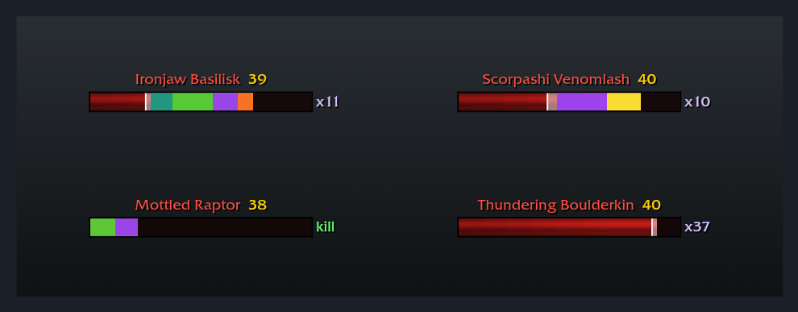
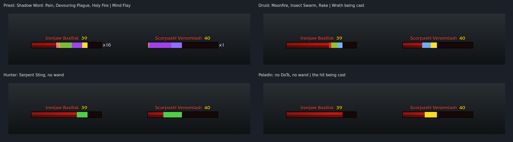

# WandBar

Shows on enemy nameplates the damage that is still coming in **WoW Forever**: the spell you
are casting, each of your DoTs tick by tick, and one wand shot after that. What stays
uncovered is the health the mob will have left, so you can see at a glance whether your DoTs
will finish it or how many wand shots it still needs.



## What it does

Coloured bands sit over the end of each enemy's health bar, eating back from where the health
ends. Nearest the edge first:

- **Yellow**: the direct hit of the spell you are casting, from the moment the cast bar starts
  until about a second after it leaves your hands.
- **A channel band**: what is left of the Drain Life, Drain Soul or Mind Flay you are
  channelling. It goes the moment you stop channelling.
- **One band per DoT** you put on that mob, in that DoT's colour, shrinking with each tick.
  Your own class's DoTs come first. Grey is a DoT DoesItDie tracks that WandBar has no entry
  for.
- **Pale band with a white line**: one average wand shot after all of that.
- **Beside the plate**: `kill` when your DoTs will finish the mob, otherwise `x11`, the number
  of wand shots still needed after the DoTs.

Conflagrate removes the Immolate band, a DoT whose debuff disappears (dispelled, replaced,
resisted) loses its band, and a cancelled cast loses its yellow band.

DoTs it knows:

| Class | DoTs and channels |
|---|---|
| Warlock | Immolate, Corruption, Bane (Curse) of Agony, Siphon Life, Bane (Curse) of Doom, Drain Life, Drain Soul |
| Priest | Shadow Word: Pain, Devouring Plague, Holy Fire, Mind Flay |
| Druid | Moonfire, Insect Swarm, Rake |
| Hunter | Serpent Sting (scales with ranged attack power) |
| Mage | Fireball and Pyroblast burns |
| Shaman | Flame Shock |
| Warrior | Rend |

The cast band works for any class with direct damage spells. A character with no wand gets
no wand band and no shot count; a class with no DoTs still gets the cast band.



## Commands

| Command | |
|---|---|
| `/wandbar` | Status: what is on, your average wand shot, your class's DoTs |
| `/wandbar help` | The list of commands |
| `/wandbar on`, `/wandbar off` | Everything on or off |
| `/wandbar wand` | Toggle the wand band |
| `/wandbar dots` | Toggle the DoT and channel bands |
| `/wandbar cast` | Toggle the yellow band |
| `/wandbar text` | Toggle `kill` / `xN` beside the plate |
| `/wandbar clear` | Forget the DoTs tracked so far |
| `/wandbar reset` | All settings back to their defaults (everything on) |

## Install

Download this repository (green **Code** button, **Download ZIP**), and copy the
`addons\WandBar` folder into `World of Warcraft\_forever_\Interface\AddOns`, so that you end
up with `AddOns\WandBar\WandBar.toc`. Restart WoW fully (a `/reload` doesn't find new
addons).

No other addons needed. It works on Blizzard's nameplates and on these, when installed:

- [Threat Plates](https://www.curseforge.com/wow/addons/tidy-plates-threat-plates): the bands
  go on its health bars, under its health text.
- [DoesItDie](https://www.curseforge.com/projects/1709161): it learns each DoT's real tick
  damage as the ticks land, and WandBar then uses its numbers instead of its own estimates.
  On first load WandBar hides DoesItDie's own nameplate marker, since the bands show the same
  thing per DoT (its kill icon stays); `/did` turns the marker back on.

## How it works, and its limits

- WoW Forever doesn't give addons the combat log, so WandBar can't see your DoTs tick. It
  estimates them from your casts: the target when you cast, the time, the rank's damage and
  duration from its tooltip, plus your spell power (or ranged attack power) times the spell's
  coefficient, then counts the ticks down. Crits, resists, partial absorbs and damage from
  other players aren't in it. With DoesItDie installed the DoT sizes come from real ticks.
- Tick intervals and coefficients come from WoW Forever's own spell data. Two are less sure:
  Bane of Doom's (4.0 of spell power, from the client data, not yet checked in game) and
  Serpent Sting's (0.05 of ranged attack power per tick, from Blizzard's development notes;
  the client data says 0).
- Garrote, Rip and Rupture aren't tracked (their damage depends on attack power or combo
  points in ways the tooltip doesn't show), nor ground and area spells (Rain of Fire,
  Hurricane, Consecration, traps).
- Enemy health can be hidden from addons (a "secret value") on this client. The bands still
  draw, because the game places them itself, but the `kill` / `xN` text needs real numbers
  and stays hidden while health is secret.
- Made and tested on an English client: DoTs are matched by spell name and tooltip text.

### Adding a DoT

All spell data is in `Spells.lua`. To track another DoT, add a line to its class's list:

```lua
{ name = "Shadow Word: Pain", interval = 3, coef = 0.20, school = 6,
  color = { 0.62, 0.25, 0.95, 0.95 } },
```

`interval` is the seconds between ticks, `coef` the spell power added to each tick per
point, `school` the spell power school (2 holy, 3 fire, 4 nature, 5 frost, 6 shadow, 7
arcane). The damage and duration of each rank come from the tooltip, so new ranks need no
entry. The other fields (channels, ramping ticks, projectiles, spells that end a DoT) are
explained at the top of the file.

## Licence

[MIT](LICENSE)
